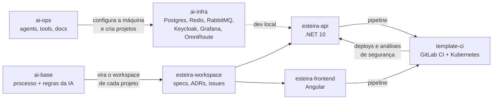

# orchestration-ai

Ecossistema de **engenharia assistida por IA, desenhado para o GitLab**: um processo de desenvolvimento (discovery → spec → tickets → TDD → review → merge request → esteira de deploy), a infraestrutura local que o sustenta, uma esteira de CI/CD reutilizável e uma plataforma que controla o fluxo de deploy.

> **Este repositório é a vitrine.** O ecossistema vive em um **grupo do GitLab com subgrupos** (`orchestration-ai/ai-pipeline/esteira/...`). O GitHub não tem subgrupos, então aqui cada projeto é um repositório da organização, agrupado pelo prefixo `orchestration-ai-` e pelo *topic* [`orchestration-ai`](https://github.com/search?q=topic%3Aorchestration-ai+org%3Adanielbmendprofissional&type=repositories). O histórico de commits é o original, completo.

## Estrutura original no GitLab × espelho no GitHub

```
GitLab (grupo e subgrupos)                    GitHub (organização plana)
orchestration-ai/                             danielbmendprofissional/
├── ai-base                                   ├── orchestration-ai-base
├── ai-ops                                    ├── orchestration-ai-ops
├── ai-infra                                  ├── orchestration-ai-infra
└── ai-pipeline/                              │
    ├── template-ci                           ├── orchestration-ai-pipeline-template-ci
    └── esteira/                              │
        ├── esteira-workspace                 ├── orchestration-ai-pipeline-esteira-workspace
        ├── esteira-api                       ├── orchestration-ai-pipeline-esteira-api
        └── esteira-frontend                  └── orchestration-ai-pipeline-esteira-frontend
```

## Como as peças se encaixam



## Os repositórios

| Repositório | Papel | GitLab |
|---|---|---|
| [`orchestration-ai-base`](https://github.com/danielbmendprofissional/orchestration-ai-base) | O **processo**: workflow completo, skills, regras e subagentes do Claude Code (`data`, `backend`, `front`, `tests`, `security`, `review`). Stack-agnóstico no backend, Angular fixo no front. Todo projeto novo nasce dele. | `orchestration-ai/ai-base` |
| [`orchestration-ai-ops`](https://github.com/danielbmendprofissional/orchestration-ai-ops) | **Operação da IA**: agents (configuração do ambiente local, versões da infra), ferramentas (ranking empírico de modelos do gateway) e documentação para humanos. | `orchestration-ai/ai-ops` |
| [`orchestration-ai-infra`](https://github.com/danielbmendprofissional/orchestration-ai-infra) | **Infra compartilhada de dev local** em Docker: uma instância de cada serviço atende todos os projetos, cada um com a sua "casa" (banco, realm, vhost, usuário ACL). Configuração como código (`projects.json` + `infra-config.mjs`), observabilidade e backup. | `orchestration-ai/ai-infra` |
| [`orchestration-ai-pipeline-template-ci`](https://github.com/danielbmendprofissional/orchestration-ai-pipeline-template-ci) | **Template de CI/CD do GitLab** para .NET 10 e Angular, tudo em container e publicado em Kubernetes (k3s/k3d) via GitLab Agent. Fluxo por tag `dev → qa → hml → main`, *build once / deploy many* por digest, e portão de segurança (Trivy, Opengrep, Checkov, Betterleaks, ZAP). | `orchestration-ai/ai-pipeline/template-ci` |
| [`orchestration-ai-pipeline-esteira-workspace`](https://github.com/danielbmendprofissional/orchestration-ai-pipeline-esteira-workspace) | **Workspace da Esteira**: regras, ADRs, specs de fatia e mapa de contexto. Primeiro projeto gerado a partir do `ai-base`. | `orchestration-ai/ai-pipeline/esteira/esteira-workspace` |
| [`orchestration-ai-pipeline-esteira-api`](https://github.com/danielbmendprofissional/orchestration-ai-pipeline-esteira-api) | API da **Esteira** (.NET 10): controla o fluxo de deploy por etapas (GMUD, banco, aprovações, DEV/QA/HML/PRD) e recebe deploys e análises de segurança das pipelines. | `orchestration-ai/ai-pipeline/esteira/esteira-api` |
| [`orchestration-ai-pipeline-esteira-frontend`](https://github.com/danielbmendprofissional/orchestration-ai-pipeline-esteira-frontend) | Front da **Esteira** (Angular), com configuração em runtime e sessão via BFF. | `orchestration-ai/ai-pipeline/esteira/esteira-frontend` |

## Decisões que valem destacar

- **Um repositório por componente, workspace por projeto.** O workspace guarda regras, specs e issues; `-api` e `-frontend` são repositórios próprios, ignorados pelo workspace.
- **Execução multimodelo.** O mesmo fluxo roda com Claude, ou com modelos pagos e gratuitos atrás de um gateway local (OmniRoute), configurado só por código (`omniroute-config.mjs`).
- **Configuração como código.** Infra, projetos e versões saem de manifestos versionados, com rótulo `project` isolando cada projeto na observabilidade.
- **Segurança no pipeline.** SAST, SCA, IaC, segredos, imagem e DAST agregados em um *gate* que bloqueia por severidade.
- **ADRs.** Paginação, erros, autenticação BFF, stack do frontend e configuração em runtime estão registrados na Esteira.

## Aviso

Os repositórios foram pensados para rodar dentro do GitLab (grupos, GitLab CI, GitLab Agent, `glab`). Remotes, caminhos de CI e referências a `gitlab.com/orchestration-ai` são mantidos como no original. Skills de terceiros não são copiadas: cada projeto lista as que usa em `skills-lock.json`.
